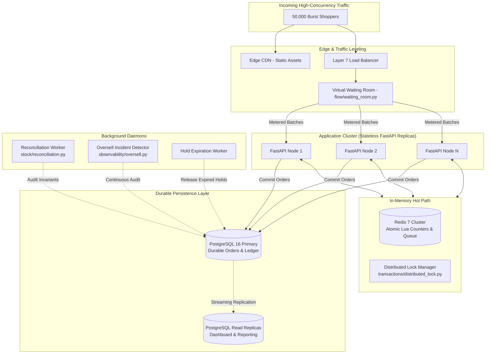

# System Architecture & Scaling

## High-Level Architecture Flowchart

---

## 100x Scale-Up & The First 3 Bottlenecks
When traffic scales from 1,000 RPS to 100,000 RPS:
1. **Bottleneck 1: Database Row Contention on Hot SKU**: 100,000 requests attempting to update the same single database row will hit row-level write lock queues.
   - *Fix*: Offload inventory counters to **Redis Lua**, maintaining in-memory stock counters and flushing to PostgreSQL in asynchronous batched commits.
2. **Bottleneck 2: Virtual Waiting Room Memory Footprint**: Storing 1,000,000 queued user tickets in FastAPI process memory causes high RAM usage and prevents horizontal scaling.
   - *Fix*: Move queue state to **Redis Sorted Sets (`ZADD`, `ZRANGEBYSCORE`)** with user timestamps as scores.
3. **Bottleneck 3: Third-Party Payment Gateway Rate Limits**: Payment gateways (e.g. Stripe) cap API throughput at 100-500 requests per second.
   - *Fix*: Decouple payment submission via an asynchronous message queue (Apache Kafka or AWS SQS) and process payments via consumer worker pools.
