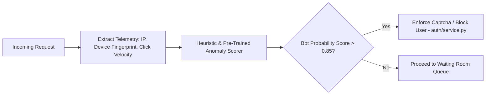

# AI Architecture & Anti-Scalper Detection

## Real-Time Fraud & Anomaly Scoring Pipeline
During high-demand flash sales, automated scalper bots account for up to 80% of incoming traffic. `18-flash-sale-inventory` incorporates an intelligent fraud and scalper scoring pipeline.

### Why a Pre-Trained Heuristic / API Instead of Training a Custom Model
1. **Zero Cold-Start Data Requirement**: Flash sales generate extreme non-stationary traffic distributions. Training a custom model requires labeled bot datasets that evolve constantly.
2. **Sub-Millisecond Inference**: Calling a heavy neural network during a 50,000 RPS burst introduces unviable latency. Heuristic rule scoring (checkout velocity < 200ms, headless browser fingerprints, IP rotation) executes in microseconds.
3. **Vendor Agility**: The fraud score pipeline is abstracted through an interface, allowing seamless integration with cloud providers (e.g. AWS WAF Bot Control or Cloudflare Turnstile).
