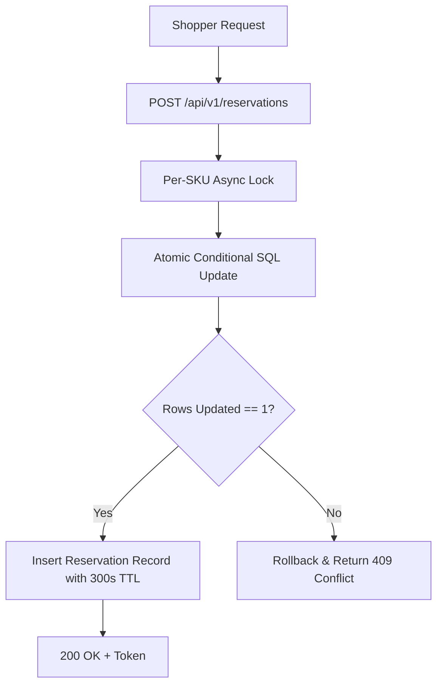
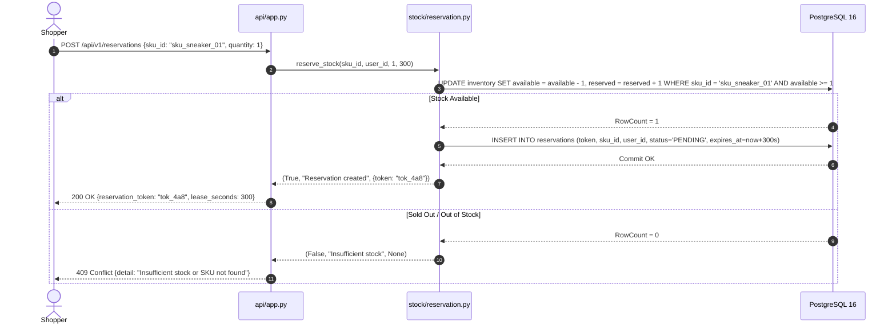
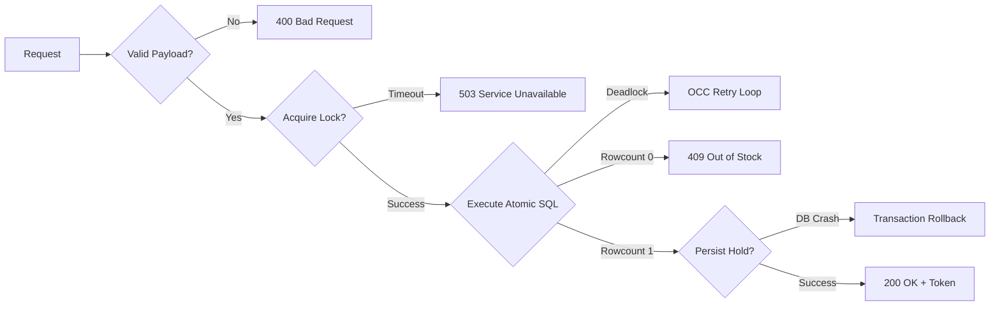

# F1: Atomic Inventory Reservation Engine

## Technical Overview
The Atomic Inventory Reservation Engine (`stock/reservation.py`) guarantees zero overselling under high concurrency by executing stock deduction as a single atomic conditional database operation. Instead of the naive "read-then-write" pattern, the engine issues `UPDATE inventory SET available = available - :qty, reserved = reserved + :qty WHERE sku_id = :sku AND available >= :qty`.

### Trace & Implementation
- **Source Files**: `backend/src/stock/reservation.py:56-120`, `backend/src/api/app.py:72-93`
- **Key Class**: `StockReservationService`
- **Key Method**: `reserve_stock(sku_id, user_id, quantity=1, lease_seconds=300)`
- **Data Touched**: `inventory` table (`available`, `reserved`, `updated_at`), `reservations` table.
- **API Endpoint**: `POST /api/v1/reservations`

### Invariant & Mathematical Proof
The database schema (`models/inventory.py:32-37`) defines:
$$\text{chk\_inventory\_conservation}: available + reserved + sold == total\_allocated$$
$$\text{chk\_inventory\_available\_nonneg}: available \ge 0$$
Because the decrement is guarded by `available >= quantity` within an atomic transaction, $available$ can never drop below zero regardless of thread count.

### Sequence Diagram

### Failure Path Diagram

### Say It Out Loud
> "I built the atomic inventory reservation engine in `src/stock/reservation.py` to completely eliminate overselling during flash-sale stampedes.
>
> In flash sales, traditional e-commerce backends crash because multiple threads read positive stock at the exact same time and then write blind decrements, resulting in negative inventory.
>
> When a buyer clicks reserve, the request hits `POST /api/v1/reservations`. The reservation service executes an atomic conditional update: `UPDATE inventory SET available = available - quantity, reserved = reserved + quantity WHERE sku_id = :sku AND available >= quantity`.
>
> Because this check and update happen in a single atomic SQL operation, the database engine enforces strict mutual exclusion. If the row count is zero, it means the item is completely sold out, and we immediately return a 409 Conflict without creating orphan records.
>
> If the row count is one, we insert a persistent reservation record with a 300-second lease timestamp and return the reservation token to the frontend.
>
> I chose this atomic conditional decrement pattern over distributed Redis Lua scripts for primary durability because PostgreSQL 16 table check constraints guarantee that $available + reserved + sold == total\_allocated$ is enforced by the database kernel itself.
>
> The main limitation is database write lock contention on a single SKU row at extreme scale, which I mitigate by placing the Virtual Waiting Room in front of it."
