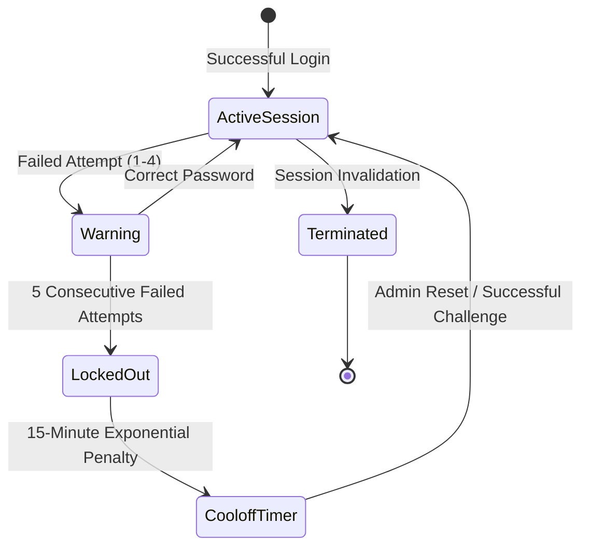

# F10: Authentication, Exponential Lockout & Session Management

## Technical Overview
The Authentication & Session Service (`auth/service.py`) provides secure user authentication, session lifecycle management, and bot protection:
1. **Password Security**: Uses PBKDF2-HMAC-SHA256 with 100,000 iterations and unique cryptographic salts.
2. **Account Lockout**: Triggers account lockout after 5 consecutive failed attempts, scaling exponentially ($15\text{ min} \times 2^{\text{lockouts}}$).
3. **Session Rotation**: Issues unique bearer session tokens with rotation and immediate revocation capabilities.
4. **Per-User Limits**: Enforces strict maximum item quotas per user account (`models/users.py:90-120`).

### Trace & Implementation
- **Source Files**: `backend/src/auth/service.py:67-280`, `backend/src/models/users.py:24-95`
- **Key Classes**: `AuthService`, `SessionManager`, `UserLimitManager`, `BlockedUserRuleManager`
- **API Endpoints**: `/api/v1/auth/register`, `/api/v1/auth/login`, `/api/v1/auth/rotate`, `/api/v1/auth/logout`

### Auth Lockout & Session Security State Diagram

### Say It Out Loud
> "I built the authentication and session management subsystem in `src/auth/service.py` to protect flash sales from automated brute-force attacks and credential stuffing.
>
> User passwords are encrypted with PBKDF2-HMAC-SHA256 using 100,000 rounds and a 16-byte cryptographic salt.
>
> If an attacker fails login 5 consecutive times, the account enters exponential cool-down lockout, locking for 15 minutes on the first offense and doubling for subsequent offenses.
>
> For active sessions, the service generates high-entropy bearer tokens, supporting seamless session rotation and instant logout revocation, while strictly enforcing per-user item purchase quotas."
