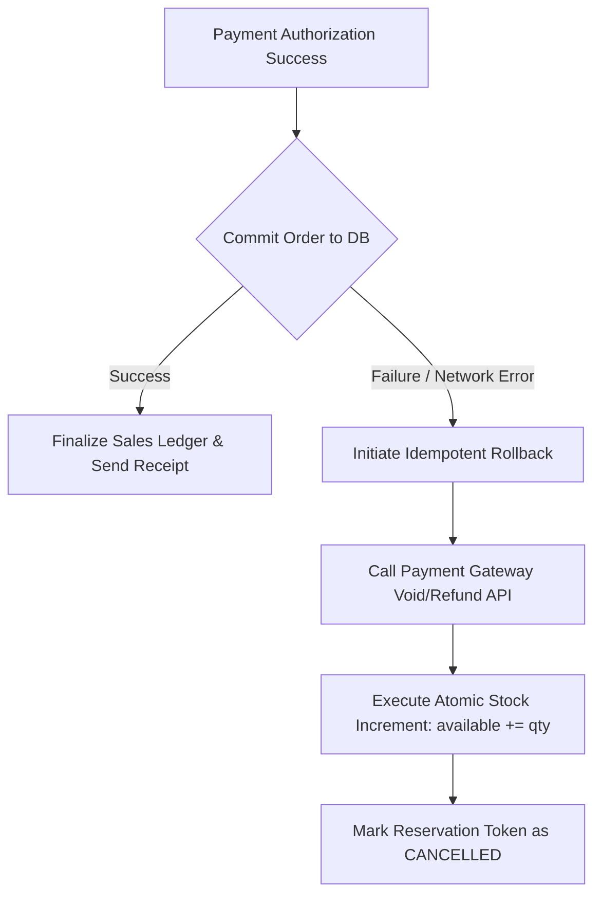

# F11: Order Lifecycle, Idempotent Payments & Refunds

## Technical Overview
The Order & Payment Service (`flow/order_payments.py`) enforces strict transactional integrity across order states and external payment gateways:
1. **Legal State Machine**: Enforces valid transitions via `OrderStateMachine` (`PENDING -> PAID -> REFUNDED`).
2. **Idempotent Payment Retries**: Guarantees that retrying a payment with the same idempotency key never charges the customer twice.
3. **Refund Limits**: Enforces that refund amounts cannot exceed the original captured payment.
4. **Order Cancellation**: Automatically restores inventory when an order is cancelled or payment fails.

### Trace & Implementation
- **Source Files**: `backend/src/flow/order_payments.py:25-240`, `backend/src/models/orders.py:21-46`
- **Key Classes**: `OrderPaymentService`, `OrderStateMachine`
- **Key Methods**: `retry_payment_idempotent()`, `initiate_refund()`, `cancel_order_with_stock_release()`

### Payment Resilience & Refund Rollback Flowchart

### Say It Out Loud
> "I built the order lifecycle and payment resilience service in `src/flow/order_payments.py` to prevent double-charging and order state corruption.
>
> All order transitions are governed by a deterministic table-driven state machine. Once an order is marked `PAID`, it can only transition to `REFUNDED`; illegal transitions are rejected at runtime.
>
> When submitting payment, each request carries a unique idempotency key. If a network blip occurs and the user clicks pay again, our service detects the existing payment key and returns the confirmed transaction immediately without touching the payment gateway.
>
> If an order is cancelled, the service automatically releases reserved stock back to the inventory pool."
