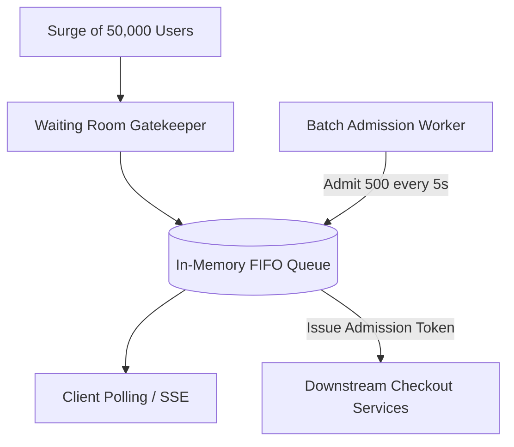
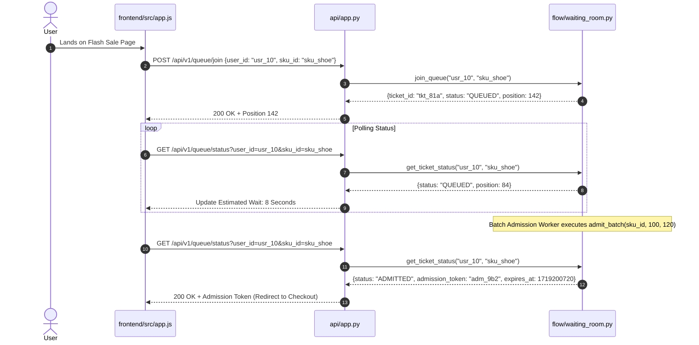

# F2: Virtual Waiting Room & Traffic Leveling

## Technical Overview
The Virtual Waiting Room (`flow/waiting_room.py`) regulates traffic surges during flash-sale openings. When 50,000 users arrive simultaneously, the waiting room enqueues shoppers into a FIFO waiting queue, issues verifiable admission tickets, and meters entry into the checkout flow in controlled batches matching downstream gateway capacity.

### Trace & Implementation
- **Source Files**: `backend/src/flow/waiting_room.py:36-150`, `backend/src/api/app.py:558-581`
- **Key Class**: `WaitingRoomManager`
- **Key Methods**: `join_queue(user_id, sku_id)`, `get_ticket_status(user_id, sku_id)`, `admit_batch(sku_id, batch_size, lease_seconds)`
- **API Endpoints**: `POST /api/v1/queue/join`, `GET /api/v1/queue/status`, `POST /api/v1/queue/admit`

### Sequence Diagram

### Say It Out Loud
> "I built the Virtual Waiting Room in `src/flow/waiting_room.py` to prevent our checkout database and payment APIs from collapsing under sudden traffic spikes.
>
> When thousands of shoppers rush to buy a product at the exact second a flash sale starts, allowing all of them to hit checkout simultaneously causes connection pool starvation and timeouts.
>
> In my architecture, incoming shoppers call `POST /api/v1/queue/join` and are placed in a FIFO queue. The system returns an admission ticket with their position and estimated wait time.
>
> The frontend polls the status endpoint every two seconds. On the backend, a background admission scheduler calls `admit_batch()`, which admits a controlled batch of 500 users every 5 seconds, issuing them a cryptographically signed admission token with a 120-second lease.
>
> Only shoppers holding an active admission token are permitted to call the reservation and checkout endpoints.
>
> I chose this virtual waiting room architecture over aggressive HTTP 429 rate limiting because dropping user requests creates a terrible customer experience. A waiting room preserves fairness, keeps buyers informed with live countdowns, and levels the load on downstream infrastructure.
>
> One limitation in the current deployment is that the queue state is held in-memory within the FastAPI process; in a multi-node cluster, I would back the queue with Redis Sorted Sets."
