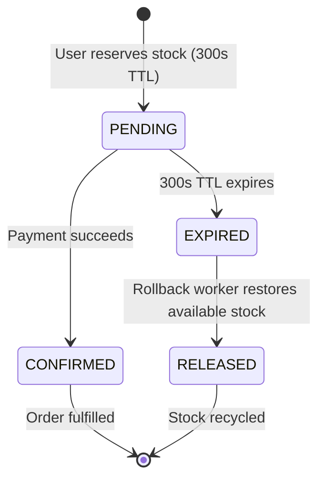

# F3: Automated Hold Expiration & Stock Rollback

## Technical Overview
When a customer reserves stock, inventory is shifted from `available` to `reserved` with a 300-second TTL (`models/inventory.py:47`). If payment confirmation is not completed before the TTL expires, the hold is marked `EXPIRED`, and the reserved units are atomically rolled back to `available` stock.

### Trace & Implementation
- **Source Files**: `backend/src/stock/reservation.py:122-180`, `backend/src/flow/checkout.py:84-110`
- **Key Functions**: `release_reservation()`, `cleanup_expired_reservations()`
- **Data Touched**: `reservations.status = 'EXPIRED'`, `inventory.reserved -= qty`, `inventory.available += qty`

### Say It Out Loud
> "I implemented automated hold expiration and stock rollback to prevent inventory hoarding and abandoned cart lockups.
>
> When a buyer reserves an item, we give them a 300-second window to complete checkout. If the buyer closes their browser or their credit card fails, we cannot leave those items locked forever.
>
> Our checkout service checks the reservation expiration timestamp against the clock before processing payment. If the lease has expired, the checkout request is rejected.
>
> Concurrently, our background reconciliation worker scans for pending reservations where `expires_at < now`. It atomically transitions the reservation status to `EXPIRED` and issues an update to decrement `reserved` stock and increment `available` stock by the exact reservation quantity.
>
> This guarantees that abandoned inventory is automatically recycled back to the sale pool for other shoppers, maintaining 100% stock utilization."
