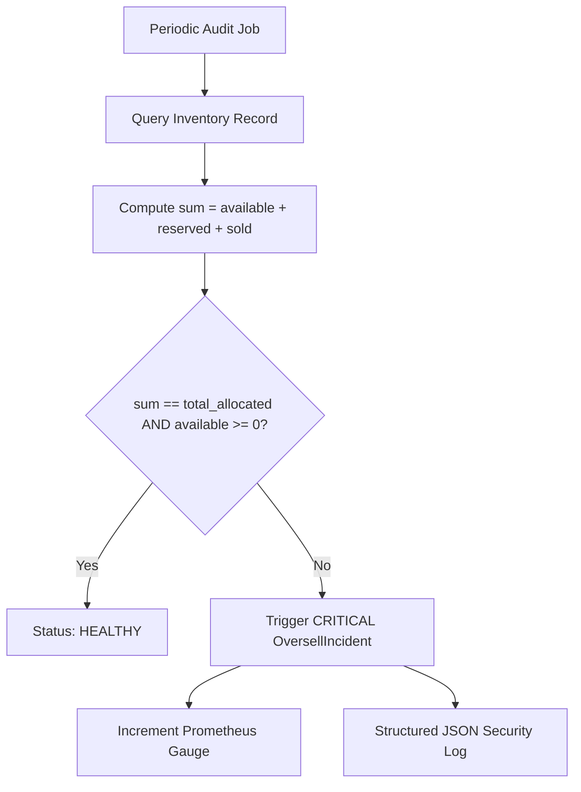

# F4: Real-time Oversell Audit Detector

## Technical Overview
The Oversell Audit Detector (`observability/oversell.py`) is an autonomous background consistency auditor that continuously scans all inventory records to verify the mathematical conservation invariant:
$$\text{Total Allocated} == \text{Available} + \text{Reserved} + \text{Sold}$$

If any discrepancy is detected—or if `available < 0` or `sold > total_allocated`—an `OversellIncident` is created, a Prometheus metric `oversell_incidents_total` is incremented, and a high-severity structured alert is logged.

### Trace & Implementation
- **Source Files**: `backend/src/observability/oversell.py:31-106`, `backend/src/api/app.py:593-616`
- **Key Class**: `OversellDetector`
- **Key Methods**: `audit_sku(session, sku_id)`, `audit_all_inventory(session)`
- **API Endpoints**: `POST /api/v1/incidents/audit`, `GET /api/v1/incidents/oversell`

### Say It Out Loud
> "I built the Real-Time Oversell Detector in `src/observability/oversell.py` to act as an active consistency monitor over our stock ledger.
>
> In financial and inventory systems, database check constraints are essential, but you also need automated runtime telemetry to detect data drift caused by edge cases or split-brain partitions.
>
> My oversell detector performs continuous table audits across all active SKUs. For each record, it verifies that the sum of available, reserved, and sold quantities strictly equals total allocated stock.
>
> If an invariant anomaly or negative stock count is detected, it logs an immutable incident with the discrepancy delta, publishes a Prometheus metric to alert our on-call team, and allows instant query via `GET /api/v1/incidents/oversell`.
>
> This ensures that if any drift ever occurs, it is detected and isolated within seconds."
