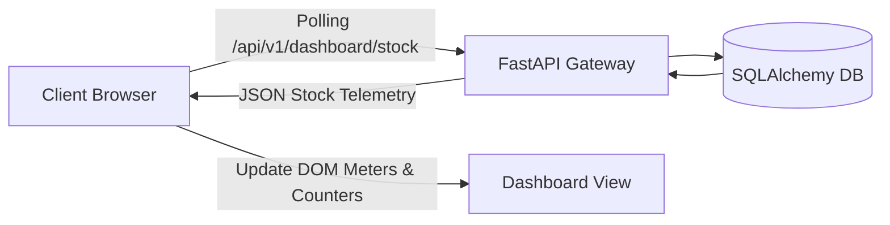

# F5: Live Storefront & Operations Console

## Technical Overview
The Storefront & Operations Console (`frontend/src/`) is built with responsive HTML5, CSS3, and modern JavaScript (`app.js`). It connects to the FastAPI backend on port 8180 to provide:
1. Live inventory progress meters displaying percentage sell-through.
2. Real-time status badges (`IN STOCK`, `LOW STOCK`, `SOLD OUT`).
3. An instant checkout reservation modal with real-time countdown timer.
4. Auto-refreshing telemetry polling every 3 seconds.

### Trace & Implementation
- **Source Files**: `frontend/src/app.js:18-120`, `frontend/src/index.html:40-150`, `frontend/src/index.css:1-180`
- **Key Functions**: `fetchInventoryFeed()`, `renderDashboard()`, `simulateReservation()`
- **Tests**: `frontend/tests/test_dashboard_monitoring.py`, `frontend/tests/test_live_stock_dashboard.py`

### Say It Out Loud
> "I built the live storefront and operations dashboard in vanilla JavaScript and CSS to provide real-time visibility into inventory velocity and sale performance.
>
> The frontend polls the `/api/v1/dashboard/stock` endpoint every three seconds. As reservations and checkouts occur, the UI recalculates total allocated, available, reserved, and sold units, dynamically updating progress meters and sell-through percentages.
>
> When inventory for a SKU drops below 20%, the badge automatically shifts from 'IN STOCK' to 'LOW STOCK' amber, and turns red when sold out.
>
> The interface also includes an interactive checkout modal that lets users simulate instant reservations, starting a live 300-second reservation hold countdown timer directly in the browser."
