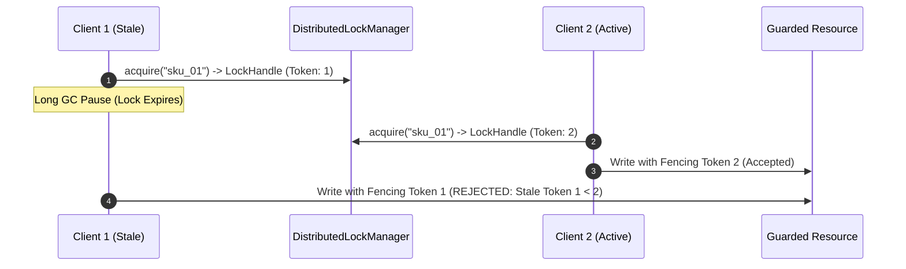

# F6: Distributed Locks with Monotonic Fencing Tokens

## Technical Overview
The Distributed Lock Manager (`transactions/distributed_lock.py`) guarantees mutual exclusion for critical sections while eliminating the classic distributed locking hazard: **stale writes caused by GC pauses or network delays**. It does this by issuing a monotonically increasing **fencing token** with every lock acquisition.

### Trace & Implementation
- **Source Files**: `backend/src/transactions/distributed_lock.py:34-130`
- **Key Class**: `DistributedLockManager`
- **Key Methods**: `acquire(resource_id, owner_id, ttl_seconds)`, `renew(handle)`, `release(handle)`
- **Exception**: `StaleLockFencingError`

### Say It Out Loud
> "I implemented distributed locking with monotonic fencing tokens in `src/transactions/distributed_lock.py` to prevent race conditions during inventory allocation.
>
> In distributed systems, simple locks are dangerous because a client might acquire a lock, experience a long garbage collection pause or network delay, lose the lock when its lease expires, and then wake up and execute a stale write that corrupts the database.
>
> To solve this Martin Kleppmann locking problem, my lock manager increments a monotonic fencing token every time a lock is acquired. When a worker writes to the resource, it must pass this fencing token.
>
> If a worker attempts to write using an older fencing token than the highest one already recorded, the write is immediately rejected with a `StaleLockFencingError`.
>
> This guarantees that even with network partitions or pause pauses, split-brain writes can never corrupt stock counts."
