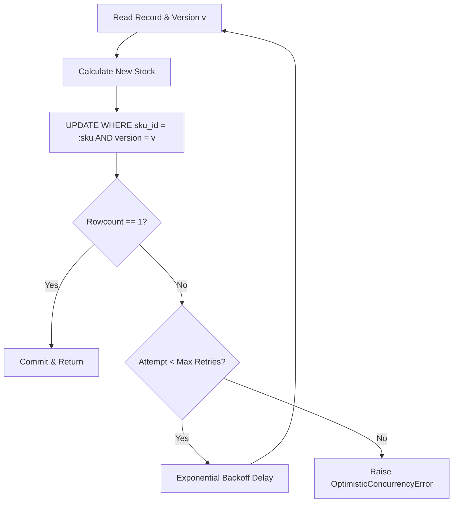

# F7: Optimistic Concurrency Control (OCC)

## Technical Overview
Optimistic Concurrency Control (`transactions/optimistic.py`) provides conflict resolution without locking database rows upfront. Every inventory record contains an incrementing `version` column. Updates verify that the version in the database matches the version read initially:
`UPDATE inventory SET available = :new_avail, version = version + 1 WHERE sku_id = :sku AND version = :cur_version`
If another transaction updated the row concurrently, the update returns a row count of 0, triggering an automatic retry with bounded exponential backoff.

### Trace & Implementation
- **Source Files**: `backend/src/transactions/optimistic.py:23-88`
- **Key Function**: `update_inventory_optimistic(session, sku_id, quantity, max_retries=5, backoff=0.01)`
- **Exception**: `OptimisticConcurrencyError`

### Say It Out Loud
> "I implemented Optimistic Concurrency Control in `src/transactions/optimistic.py` to handle concurrent stock updates without locking rows.
>
> Instead of using `SELECT FOR UPDATE` which forces concurrent database requests to block and wait in queues, OCC reads the inventory record along with its `version` integer.
>
> When applying the reservation, the update query conditions on that exact version: `WHERE sku_id = :sku AND version = :version`. If another thread modified the row in the meantime, the version check fails and zero rows are updated.
>
> When a conflict occurs, the transaction rolls back cleanly, waits with exponential backoff, and retries up to 5 times.
>
> This guarantees zero lost updates while delivering significantly higher throughput under low to moderate contention."
