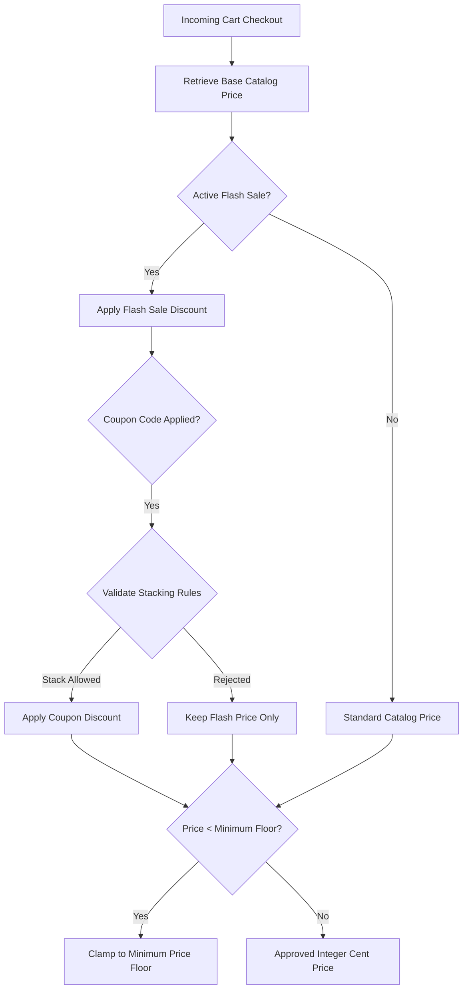

# F8: Pricing, Promotions & Stacking Rules

## Technical Overview
The Pricing Engine (`pricing/pricing.py`, `pricing/promotions.py`) computes dynamic flash-sale prices while strictly enforcing business guardrails:
1. **Original Price Preservation**: Baseline catalog price is always preserved.
2. **Price Floor Validation**: Effective price can never drop below a hard floor (e.g. wholesale cost).
3. **Maximum Discount Cap**: Total promotional discount is capped at a strict maximum percentage (e.g. 90%).
4. **Promotion Stacking Rules**: Prevents unapproved coupon and promotional stacking under concurrency.

### Trace & Implementation
- **Source Files**: `backend/src/pricing/pricing.py:11-100`, `backend/src/pricing/promotions.py:34-110`
- **Key Classes**: `PricingEngine`, `CouponManager`
- **Key Functions**: `resolve_price()`, `apply_fixed_discount()`, `validate_price_floor()`

### Architecture & Promotion Evaluation Flow

### Say It Out Loud
> "I built the pricing and promotion engine in `src/pricing/pricing.py` to ensure that flash-sale discounts never lead to negative margins or revenue leaks.
>
> When a campaign is active, our pricing engine calculates the promotional price in integer cents, avoiding floating-point rounding errors.
>
> It enforces three strict safety checks: first, the final sale price is validated against a minimum price floor so products are never sold below cost; second, maximum discount caps prevent runaway promotional compounding; and third, atomic coupon redemption ensures coupons cannot be double-used under concurrent requests."
