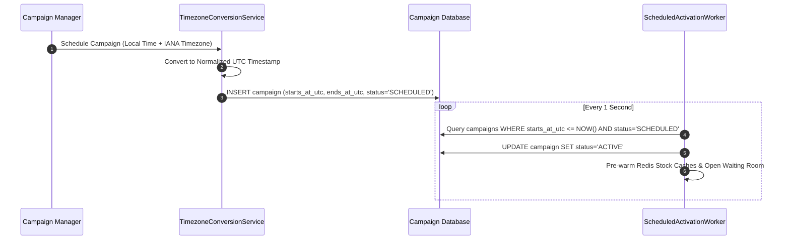

# F9: Timezone-Aware Scheduled Activation

## Technical Overview
The Scheduled Activation Engine (`sales/activation.py`) manages the lifecycle transition of flash-sale campaigns from `SCHEDULED` to `ACTIVE`. It guarantees:
1. **Documented Tolerance**: Activation occurs within $\le 1.0$ second of the target timestamp.
2. **Timezone & DST Robustness**: Converts IANA wall-clock times to UTC and correctly handles Daylight Saving Time boundary transitions.

### Trace & Implementation
- **Source Files**: `backend/src/sales/activation.py:22-120`
- **Key Classes**: `TimezoneConversionService`, `ScheduledActivationEngine`
- **Key Constant**: `ACTIVATION_TOLERANCE_SECONDS = 1.0`

### Scheduled Activation Sequence Diagram

### Say It Out Loud
> "I built the scheduled activation engine in `src/sales/activation.py` to ensure flash sales launch at the exact millisecond planned, regardless of timezone or Daylight Saving Time shifts.
>
> All campaign start and end times are stored internally in UTC. The service uses Python's `zoneinfo` to convert localized wall-clock inputs into UTC, explicitly verifying whether intervals cross DST shift boundaries.
>
> A background evaluation worker queries scheduled campaigns and activates those due within a tight 1.0-second tolerance window, updating campaign status to `ACTIVE` so product listings instantly reflect flash-sale pricing."
