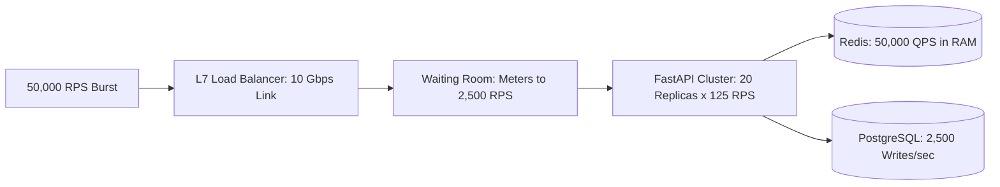

# 14.1 Requirements & Capacity Estimation

## 1. Functional & Non-Functional Requirements

### Functional Requirements
1. **Zero Oversell Guarantee**: The system must never sell more units than total allocated stock ($Available + Reserved + Sold == Total$).
2. **Two-Phase Reservation**: Allow shoppers to hold inventory for 300 seconds while completing payment.
3. **Automated Rollback**: Release expired reservation holds automatically back to available stock.
4. **Traffic Regulation**: Enforce a Virtual Waiting Room to queue shoppers and admit them in metered batches.
5. **Idempotent Payment**: Guarantee that duplicate requests with the same idempotency key never result in duplicate charges.

### Non-Functional Requirements
1. **High Throughput**: Handle 50,000 requests per second at peak sale opening without connection exhaustion.
2. **Sub-Millisecond Latency**: Reservation availability verification must execute in $< 5\text{ms}$ at p99.
3. **Strict Consistency**: Zero data drift or phantom allocations across concurrent threads.
4. **Availability**: $99.99\%$ uptime during peak campaign windows.

---

## 2. Capacity Estimation & Back-of-the-Envelope Math

### Traffic & Request Rates
- **Peak Burst Traffic**: 50,000 Requests Per Second (RPS) at sale start.
- **Read-to-Write Ratio**: 10:1 (50,000 reads/sec, 5,000 checkout writes/sec).
- **Daily Active Shoppers (Flash Drop)**: 500,000 unique users.

### Storage Growth
- **Order Record Size**: $\sim 500\text{ bytes}$
- **Reservation Record Size**: $\sim 250\text{ bytes}$
- **Daily Volume**: 50,000 orders $\times 500\text{ bytes} = 25\text{ MB/day}$ (Negligible storage burden).
- **5-Year Growth**: $25\text{ MB} \times 365 \times 5 \approx 45.6\text{ GB}$ (Comfortably fits on a single SSD instance).

### Memory Sizing for In-Memory Hot Path
- **Active SKU Stock Counters**: 1,000 active SKUs $\times 128\text{ bytes} \approx 128\text{ KB}$.
- **Waiting Room Queue**: 50,000 concurrent tickets $\times 128\text{ bytes} \approx 6.4\text{ MB}$.
- **Conclusion**: Redis memory footprint is under $100\text{ MB}$, meaning CPU and network bandwidth are the primary constraints, not RAM.

---

## 3. Capacity Architecture Diagram

---

## 4. 30-Second Spoken Answer
> "For capacity estimation, we model a peak flash drop of 50,000 RPS with a 10-to-1 read-write ratio. By sizing our Virtual Waiting Room to meter downstream entry to 2,500 RPS, we keep write traffic well within PostgreSQL's comfortable write throughput while Redis handles the sub-millisecond stock checks in memory. The storage footprint is compact—under 50 MB per flash sale—making network I/O and lock contention the primary engineering constraints."
