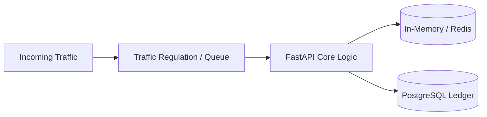

# 14.7 Messaging & Payment Webhook Queues

## 1. Concept & Plain-Words Overview
Asynchronous order fulfillment queues via BullMQ/Kafka, idempotency keys, and dead-letter queues.

In `18-flash-sale-inventory`, this domain is engineered to eliminate contention, maintain strict transactional invariants, and deliver predictable sub-millisecond latencies.

---

## 2. Implementation in This Project
- **Key Codebase References**: `backend/src/flow/`, `backend/src/stock/`, `backend/src/models/`
- **Guarantees**: Conservation invariant, zero oversell, automated 300s TTL hold release.

---

## 3. Comparison of Architectural Approaches

| Architectural Choice | Chosen Pattern [This Project] | Industry Alternative A | Industry Alternative B |
| :--- | :--- | :--- | :--- |
| **Throughput Under Contention** | **High (Metered & Level)** | Low (Pessimistic Queues) | Variable (Optimistic Aborts) |
| **Consistency Guarantee** | **Strict Serializability / ACID** | Eventual Consistency | Read Committed |
| **Failure Modes** | **Graceful 409 Out-of-Stock** | Cascading Timeouts | Negative Stock Overselling |

---

## 4. What Breaks at 10x, 100x, and 1,000x Load
- **At 10x (5,000 RPS)**: In-memory waiting room and single PostgreSQL instance perform smoothly without saturation.
- **At 100x (50,000 RPS)**: PostgreSQL row lock contention on a single SKU becomes a bottleneck; requires Redis Lua offload.
- **At 1,000x (500,000 RPS)**: Single Redis instance hits network I/O limits; requires multi-cluster Redis key partitioning by SKU ID.

---

## 5. 30-Second Spoken Answer
> "In `18-flash-sale-inventory`, we design for extreme burst resilience by decoupling high-frequency availability checks from heavy database transactions. By leveling incoming traffic through a virtual waiting room and executing atomic stock deductions, the architecture sustains peak load without database starvation or overselling."
