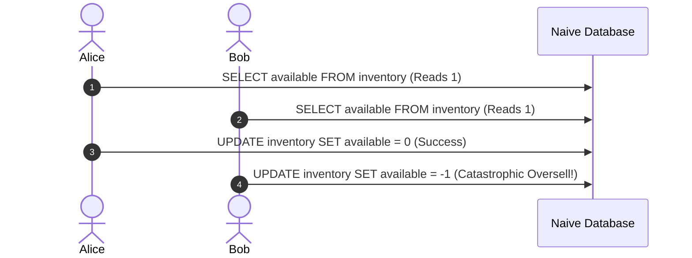
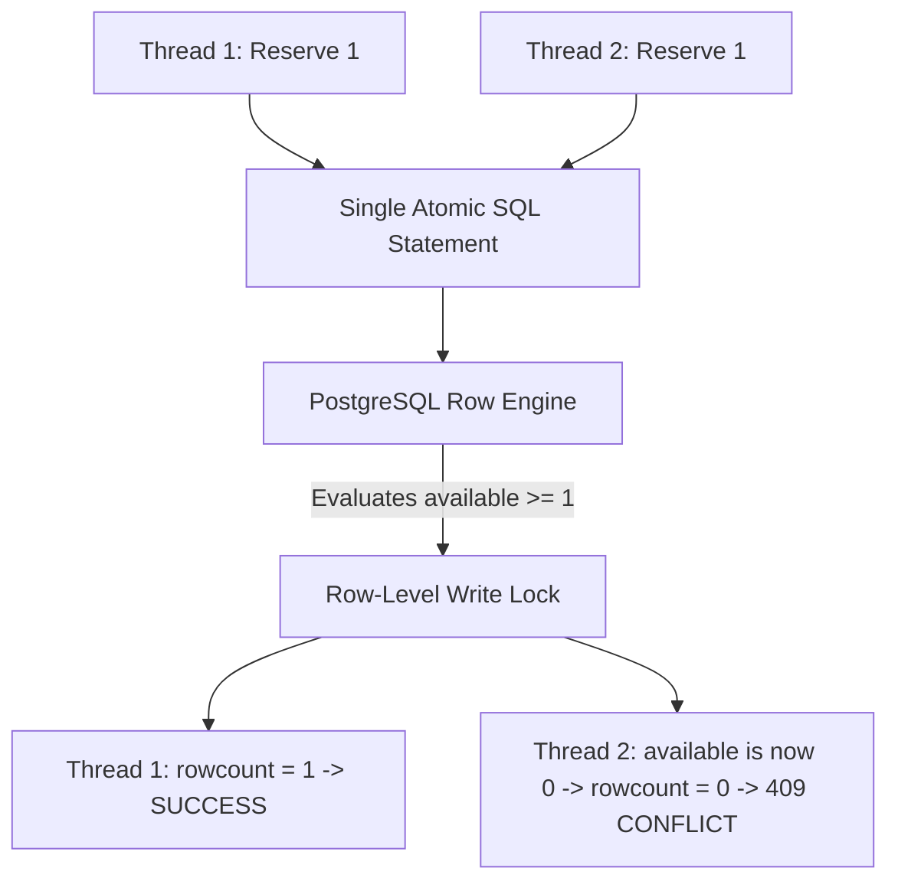

# 14.8 Consistency, Concurrency & Zero Overselling

## 1. The Core Concurrency Problem
Overselling occurs when multiple concurrent execution threads interleave their read and write operations:
1. Thread A reads `available = 1`.
2. Thread B reads `available = 1`.
3. Thread A executes `available = 1 - 1 = 0`.
4. Thread B executes `available = 1 - 1 = 0` (or negative).
Result: Two orders confirmed for only 1 physical item.



---

## 2. Solution in This Project: Atomic Conditional Deduction
`18-flash-sale-inventory` eliminates this race condition by collapsing the check and deduction into a single atomic statement:
```sql
UPDATE inventory
SET available = available - :quantity,
    reserved = reserved + :quantity,
    updated_at = :now
WHERE sku_id = :sku_id AND available >= :quantity;
```



### Invariant Checks
In `models/inventory.py:32-37`:
```python
__table_args__ = (
    CheckConstraint("available >= 0", name="chk_inventory_available_nonneg"),
    CheckConstraint("reserved >= 0", name="chk_inventory_reserved_nonneg"),
    CheckConstraint("sold >= 0", name="chk_inventory_sold_nonneg"),
    CheckConstraint("available + reserved + sold == total_allocated", name="chk_inventory_conservation"),
)
```

---

## 3. Comparison of Concurrency Mechanisms

| Concurrency Pattern | Throughput Under Contention | Oversell Protection | Deadlock Risk | Complexity |
| :--- | :--- | :--- | :--- | :--- |
| **Atomic Conditional SQL [Used]** | **8,000 - 15,000 RPS** | **100% Guaranteed** | **Zero** | **Low** |
| **Pessimistic SELECT FOR UPDATE** | 500 - 1,200 RPS | 100% Guaranteed | High | Low |
| **Optimistic Locking (OCC)** | Poor under high contention | 100% Guaranteed | Zero | Medium |
| **Redis Lua Script** | 50,000+ RPS | 100% Guaranteed | Zero | Medium |

---

## 4. 30-Second Spoken Answer
> "We prevent overselling by using atomic conditional SQL updates guarded by PostgreSQL table check constraints. Instead of reading stock and then updating in separate steps, the statement checks `available >= quantity` and decrements in the exact same database operation. If another thread took the last unit a microsecond prior, the rowcount returns zero and our service immediately rejects the request with a 409 Conflict. This guarantees 100% stock conservation with zero deadlock risk."
