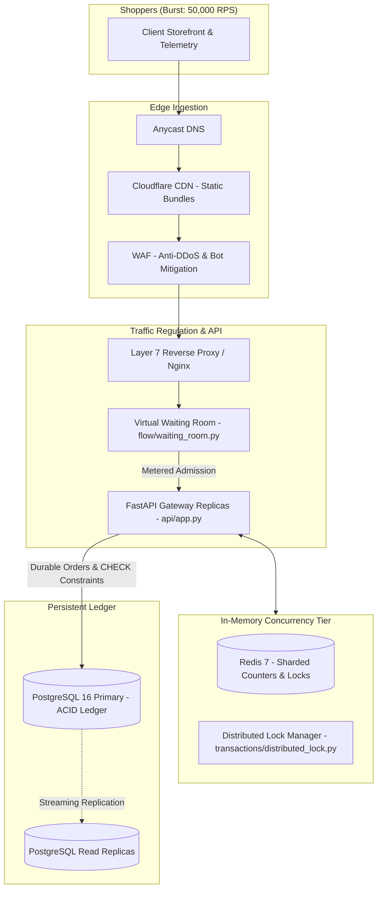

# System Design: High-Concurrency Flash Sale Architecture

Welcome to the System Design deep dive for `18-flash-sale-inventory`. This section covers distributed systems design, high-concurrency transaction engineering, and scalability planning.

---

## System Architecture Blueprint

---

## Chapters in This Guide
1. [14.1 Requirements & Capacity Estimation](./14.1-requirements-and-estimation.md)
2. [14.2 Architecture Styles & Decoupling](./14.2-architecture-styles.md)
3. [14.3 Networking & Communication Protocols](./14.3-networking-and-communication.md)
4. [14.4 Load Balancing & Scaling Strategies](./14.4-load-balancing-and-scaling.md)
5. [14.5 Databases, Two-Phase Ledgers & Sharding](./14.5-databases-and-storage.md)
6. [14.6 Caching & Pre-Warmed Stock Pools](./14.6-caching.md)
7. [14.7 Messaging, Event Streams & Queues](./14.7-messaging-and-queues.md)
8. [14.8 Consistency, Concurrency & Zero Overselling](./14.8-consistency-and-concurrency.md)
9. [14.9 Reliability, Circuit Breakers & Rollbacks](./14.9-reliability-and-resilience.md)
10. [14.10 API Design & Rate Limiting Algorithms](./14.10-api-design-and-rate-limiting.md)
11. [14.11 Security, Zero Trust & Anti-Scalper Architecture](./14.11-security-architecture.md)
12. [14.12 Search & Anomaly Detection Pipeline](./14.12-search-and-ai-architecture.md)
13. [14.13 Real-Time Stock Updates & Telemetry](./14.13-real-time-systems.md)
14. [14.14 Observability, Prometheus & Invariant Audits](./14.14-observability-and-operations.md)
15. [14.15 Performance Engineering & Sub-Millisecond Locks](./14.15-performance-engineering.md)
16. [14.16 Cost Modeling & Infrastructure Estimation](./14.16-cost-and-trade-offs.md)
17. [14.17 Classic System Design Problems Applied](./14.17-classic-system-design.md)
18. [Architecture Decision Records (ADR Log)](./decisions.md)
